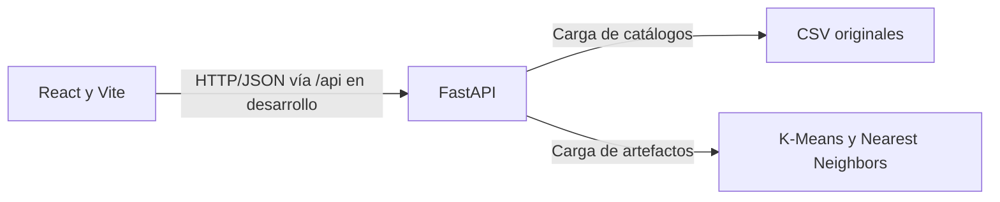

# AstroShield

Dashboard analítico interactivo para explorar **objetos cercanos a la Tierra (NEO)** y **objetos artificiales del catálogo SATCAT**. Incluye búsqueda, filtros, fichas, gráficas y un explorador orbital ilustrativo. Para los NEO, también ofrece comparación de objetos, agrupamiento con K-Means y recomendaciones con Nearest Neighbors.

> ⚠️ Los resultados son **exploratorios y comparativos**. No constituyen una predicción de impacto ni una clasificación oficial de riesgo.

---

## Tabla de contenido

1. [Arquitectura](#arquitectura)
2. [Estructura del repositorio](#estructura-del-repositorio)
3. [Requisitos previos](#requisitos-previos)
4. [Frameworks y librerías](#frameworks-y-librerías)
5. [Instalación y ejecución local](#instalación-y-ejecución-local)
6. [Pantallas](#pantallas)
7. [Pipeline de datos y modelo](#pipeline-de-datos-y-modelo)
8. [Endpoints principales de la API](#endpoints-principales-de-la-api)
9. [Pruebas](#pruebas)
10. [Flujo de trabajo en equipo](#flujo-de-trabajo-en-equipo)
11. [Solución de problemas](#solución-de-problemas)
12. [Equipo](#equipo)
13. [Alcance y limitaciones](#alcance-y-limitaciones)

---

## Arquitectura



| Componente | Tecnología | Puerto por defecto |
|---|---|---|
| Frontend | React + TypeScript + Vite | `5173` |
| Backend | Python + FastAPI + Uvicorn | `8000` |
| Modelo | scikit-learn (K-Means, NearestNeighbors) | — |

## Estructura del repositorio

```
astroshield/
├── data/
│   ├── raw/              # CSV originales (neo_v2.csv, satcat.csv). NO se modifican
│   └── processed/        # Datos preparados (generados por scripts)
├── notebooks/            # Carpeta reservada para notebooks
├── ml/
│   ├── src/train.py      # Preprocesamiento, entrenamiento y evaluación
│   └── artifacts/        # model.joblib y metrics.json incluidos
├── backend/
│   ├── app/
│   │   ├── routers/      # Endpoints (neo, satcat, ia)
│   │   ├── schemas/      # Modelos Pydantic (validación de entradas/salidas)
│   │   ├── services/     # Carga de datos, inferencia, similitud
│   │   └── core/         # Configuración y variables de entorno
│   ├── tests/            # Pruebas de la API
│   └── requirements.txt
├── frontend/             # Aplicación React, pruebas y package-lock.json
├── docs/
│   ├── API.md            # Contrato de la API y ejemplos
│   ├── entregas/         # PDF de requerimientos
│   └── mockups/          # Carpeta reservada para mockups
├── .env.example
└── README.md
```

## Requisitos previos

| Herramienta | Versión de referencia | Verificar con |
|---|---|---|
| Git | 2.51.0 | `git --version` |
| Python | 3.13.14 | `python --version` |
| Node.js | 22.19.0 | `node --version` |
| npm | 11.8.0 | `npm --version` |

## Frameworks y librerías

El backend toma las versiones de `backend/requirements.txt`. En el frontend, `npm ci` instala las versiones fijadas en `frontend/package-lock.json`.

### Backend (Python)

| Framework o librería | Versión | Uso |
|---|---|---|
| FastAPI | 0.115.12 | API del backend |
| Uvicorn | 0.34.2 | Servidor ASGI |
| pandas | 2.2.3 | Procesamiento de datos |
| scikit-learn | 1.6.1 | K-Means y Nearest Neighbors |
| joblib | 1.4.2 | Persistencia del modelo entrenado |
| python-dotenv | 1.1.0 | Variables de entorno |
| pytest | 8.3.5 | Pruebas del backend |
| httpx | 0.28.1 | Cliente HTTP para pruebas |

### Frontend (Node.js)

| Framework o librería | Versión | Uso |
|---|---|---|
| React | 19.3.1 | Interfaz de usuario |
| React DOM | 19.3.1 | Renderizado en el navegador |
| TypeScript | 5.9.3 | Tipado estático |
| Vite | 7.3.8 | Servidor de desarrollo y compilación |
| @vitejs/plugin-react | 5.2.0 | Integración de React con Vite |
| TanStack React Query | 5.108.2 | Consumo y caché de la API |
| Vitest | 4.1.12 | Pruebas del frontend |
| Testing Library (React) | 16.3.3 | Pruebas de componentes |
| jsdom | 27.4.0 | Entorno de pruebas |
| @types/react | 19.3.0 | Tipos de React |
| @types/react-dom | 19.3.0 | Tipos de React DOM |
| @fontsource/ibm-plex-sans | 5.3.0 | Tipografía |
| @fontsource/newsreader | 5.3.0 | Tipografía |

## Instalación y ejecución local

La entrega se ejecuta localmente con Python y Node.js.

### 1. Clonar el repositorio

```bash
git clone https://github.com/Mald0nad00/AstroShield.git
cd AstroShield
```

### 2. Verificar los archivos incluidos

| Archivo | Contenido |
|---|---|
| `data/raw/neo_v2.csv` | 90,836 aproximaciones de NEO |
| `data/raw/satcat.csv` | 70,587 registros SATCAT |
| `ml/artifacts/model.joblib` | Preprocesador, modelo e índice de vecinos |
| `ml/artifacts/metrics.json` | Métricas de entrenamiento y validación |

### 3. Iniciar el backend

Desde la raíz del repositorio, ejecuta en PowerShell:

```powershell
python -m venv .venv
.\.venv\Scripts\python.exe -m pip install -r backend/requirements.txt
.\.venv\Scripts\python.exe -m uvicorn app.main:app --app-dir backend --host 127.0.0.1 --port 8000
```

En macOS y Linux, el intérprete del entorno virtual está en `.venv/bin/python`.

- Estado de la API en <http://127.0.0.1:8000/health>
- Documentación interactiva en <http://127.0.0.1:8000/docs>

### 4. Iniciar el frontend

Abre otra terminal en la raíz del repositorio y ejecuta:

```bash
cd frontend
npm ci
npm run dev
```

Abre la aplicación en <http://127.0.0.1:5173>. Vite reenvía las solicitudes de `/api` a `http://127.0.0.1:8000`. Ambos servicios tienen valores predeterminados para el arranque local.

### Configuración opcional

- Si el navegador consulta la API desde otro origen, configura `FRONTEND_URL` en un `.env` de la raíz con el origen exacto de la aplicación.
- Para una compilación que apunte a otra API, configura `VITE_API_URL` en `frontend/.env` antes de ejecutar `npm run build`. Si usas la ruta predeterminada `/api`, el servidor que aloje la compilación debe redirigirla al backend.
- Mantén los archivos `.env` fuera de Git.

## Pantallas

| Pantalla | Funcionalidad |
|---|---|
| Inicio | Resumen de los catálogos y acceso a las secciones |
| Catálogo NEO | Filtros, indicadores, gráficas, fichas y comparación entre dos objetos |
| Análisis IA | Métricas del modelo, perfiles de grupo y búsqueda de NEO similares |
| SATCAT | Filtros, indicadores, distribuciones y fichas de objetos artificiales |
| Explorador orbital | Vistas ilustrativas del entorno terrestre y la vecindad NEO |

Consulta el [README del frontend](frontend/README.md) para más detalles sobre las pantallas y su relación con la maqueta.

## Pipeline de datos y modelo

El repositorio incluye el modelo entrenado. Si cambias el catálogo NEO o necesitas regenerar el modelo, ejecuta desde la raíz:

```powershell
.\.venv\Scripts\python.exe ml/src/train.py
```

El script valida las filas, aplica `log1p` a los diámetros, escala con `StandardScaler`, evalúa de 2 a 6 grupos y guarda el modelo de cuatro grupos y el índice de vecinos. Sobrescribe `ml/artifacts/model.joblib` y `ml/artifacts/metrics.json`. Reinicia la API después de regenerarlos.

| Configuración | Silhouette | Davies-Bouldin | Calinski-Harabasz |
|---|---|---|---|
| Modelo incluido (4 grupos) | 0.3133 | 1.0913 | 10086.93 |
| Referencia (2 grupos) | 0.4136 | 1.0533 | 11567.10 |

Los valores corresponden a validación. Ambas configuraciones superan el objetivo de Silhouette de 0.25. La referencia de dos grupos obtuvo el mayor Silhouette.

- **Variables.** `est_diameter_min`, `est_diameter_max`, `relative_velocity`, `miss_distance` y `absolute_magnitude`.
- **Campos excluidos del agrupamiento.** `id`, `name` y `hazardous`. Este último se conserva como etiqueta de referencia.
- **Partición.** 80 % para entrenamiento y 20 % para validación, con `random_state = 42`. El escalado se ajusta con los datos de entrenamiento.

## Endpoints principales de la API

Consulta [docs/API.md](docs/API.md) o prueba los endpoints en <http://127.0.0.1:8000/docs>.

| Método | Ruta | Descripción | Req. |
|---|---|---|---|
| `GET` | `/health` | Estado y número de registros cargados | — |
| `GET` | `/filtros` | Opciones para selects y rangos de sliders | RF02 |
| `GET` | `/search?q=` | Búsqueda por nombre/id en ambos catálogos | RF01 |
| `GET` | `/neo` | Lista paginada con filtros | RF01, RF02, RF09 |
| `GET` | `/neo/stats` | KPIs, histogramas de diámetro y velocidad, conteo por grupo | RF05, gráf. 2–4 |
| `GET` | `/neo/scatter` | Puntos diámetro vs velocidad por grupo (`limit`, máx. 20000) | gráf. 1 |
| `GET` | `/neo/compare?a=&b=` | Dos NEO lado a lado | RF04, gráf. 5 |
| `GET` | `/neo/{neo_id}` | Ficha, unidades y todas sus aproximaciones | RF03 |
| `GET` | `/satcat` | Lista paginada con filtros | RF01, RF02, RF08 |
| `GET` | `/satcat/stats` | KPIs, por tipo, por régimen, propietarios, lanzamientos/año, inclinación | RF08, gráf. 6 |
| `GET` | `/satcat/{norad_id}` | Ficha del objeto | RF03 |
| `POST` | `/ia/inferencia` | Grupo asignado y objetos similares (por `id` o por las 5 variables) | RF06, RF07 |
| `GET` | `/ia/clusters` | Resumen de cada grupo (tamaño, % peligrosos, media/mediana/rango) | RF06 |
| `GET` | `/ia/metricas` | Métricas del modelo | — |

**Filtros NEO** (`/neo`, `/neo/stats`, `/neo/scatter`): `q`, `cluster` (repetible: `?cluster=1&cluster=3`), `hazardous`,
`diam_min`/`diam_max` (km), `vel_min`/`vel_max` (km/s), `moid_min`/`moid_max` (UA).
**Filtros SATCAT.** `q`, `object_type` (`PAY`, `R/B`, `DEB`, `UNK`), `regime` (`LEO`, `MEO`, `GEO`, `HEO`, `NO_TERRESTRE`, `DESCONOCIDO`), `owner` e `in_orbit`. Se puede repetir `object_type` y `regime`.
**Listas**: `page`, `page_size` (máx. 500), `sort`, `desc`. Respuesta: `{total, page, page_size, items}`.
`/stats` acepta `bins` (5–100).

### Interpretación de los datos

- Los grupos se numeran **1..4** (como en los mockups).
- En `neo_v2.csv` un mismo NEO aparece una vez por aproximación (90,836 filas, 27,423 objetos). Las listas devuelven filas; la ficha, la comparación y la inferencia por `id` usan la aproximación más cercana.
- El dataset no tiene MOID real: se usa `miss_distance` convertido a UA (`miss_distance_au`). La velocidad viene en km/h y se expone también en km/s (`velocity_km_s`).
- El régimen SATCAT se deriva del centro orbital y de las altitudes de apogeo y perigeo. `in_orbit` indica que el registro carece de una fecha de reingreso.

### Ejemplo de inferencia

Cuerpo de la petición a `POST /ia/inferencia`:

```json
{
  "id": 2162635,
  "k": 2
}
```

Ejemplo de respuesta. `tiempo_ms` varía en cada ejecución.

```json
{
  "id": 2162635,
  "cluster_asignado": 4,
  "objetos_similares": [
    { "id": 2154589, "name": "154589 (2003 MX2)", "cluster": 4, "distancia": 0.1868 },
    { "id": 2137044, "name": "137044 (1998 UC50)", "cluster": 4, "distancia": 0.4327 }
  ],
  "estado": "procesado",
  "tiempo_ms": 1762.9,
  "aviso": "Grupos exploratorios de K-Means; no constituyen predicción de impacto ni clasificación oficial de riesgo."
}
```

`k` indica cuántos objetos similares se solicitan (de 1 a 50, con 5 por defecto). También se puede enviar el conjunto completo de cinco variables, con los diámetros y la distancia en km y la velocidad en km/h.

## Pruebas

Para comprobar la API desde la raíz del repositorio:

```powershell
Push-Location backend
..\.venv\Scripts\python.exe -m pytest
Pop-Location
```

Para ejecutar las pruebas del frontend y comprobar la compilación, desde la raíz:

```bash
cd frontend
npm test
npm run build
```

El comando de compilación verifica los tipos de TypeScript y genera `frontend/dist/`.

## Flujo de trabajo en equipo

**Ramas**

- `main`: versión estable / entregable.
- `develop`: integración del equipo.
- `feature/<nombre>`: una rama por tarea, creada desde `develop`.

**Ciclo de trabajo**

```bash
git checkout develop
git pull origin develop
git checkout -b feature/mi-tarea

# ... trabajar ...

git add .
git commit -m "feat(ml): descripción breve"
git push -u origin feature/mi-tarea
```

Luego abre un **Pull Request** hacia `develop` y pide revisión a un compañero.

**Convención de commits**

| Prefijo | Uso |
|---|---|
| `feat:` | Nueva funcionalidad |
| `fix:` | Corrección de error |
| `docs:` | Documentación |
| `chore:` | Mantenimiento / estructura |
| `refactor:` | Reorganización de código sin cambiar comportamiento |

**Reglas del equipo**

1. Haz `git pull` antes de empezar a trabajar.
2. No edites `data/raw/`; todo dato transformado va en `data/processed/`.
3. No subas `.env`, `.venv/` ni `node_modules/`.
4. Una sola persona edita cada notebook a la vez.
5. Si agregas una dependencia de Python, actualiza `requirements.txt` (`pip freeze > requirements.txt`).

## Solución de problemas

| Problema | Solución |
|---|---|
| Python no encuentra Uvicorn | Instala `backend/requirements.txt` con el intérprete de `.venv`. |
| `ModuleNotFoundError: app` al iniciar la API | Ejecuta Uvicorn desde la raíz con `--app-dir backend`. |
| El frontend no conecta con la API | Comprueba que `http://127.0.0.1:8000/health` responda. Si cambias el puerto de la API, ajusta también el destino del proxy en `frontend/vite.config.ts`. |
| Error de CORS al consultar la API directamente | Ajusta `FRONTEND_URL` al origen exacto del frontend y reinicia la API. |
| Falta el modelo o cambió el catálogo NEO | Regenera los artefactos siguiendo el [pipeline de datos y modelo](#pipeline-de-datos-y-modelo). |
| Puerto ocupado | Libera el puerto antes de iniciar el servicio. |

## Equipo

**Grupo LITIID73 · AstroShield**

- David Alejandro Herrera Maldonado
- Cristian Israel García Zapata
- Paola Guadalupe Ceh Lopez
- José Valentín Gómez Martínez

---

## Alcance y limitaciones

- No se realiza cálculo ni propagación orbital de alta precisión.
- No se predicen impactos ni se generan alertas oficiales de riesgo.
- El explorador orbital es únicamente ilustrativo.
- Los grupos de K-Means son exploratorios y no sustituyen sistemas oficiales de vigilancia espacial.
